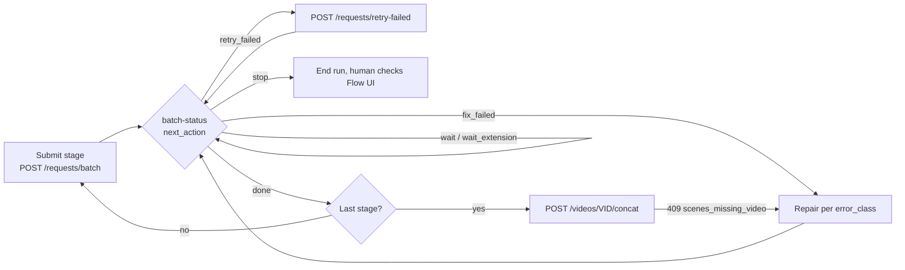

# Running a Flow Kit pipeline from a tool: stages, trace, repair, concat

For tools that drive a whole video (phoikhi, Radar, Stock Shorts on `flow`,
scripts): submit a stage, wait on the server's verdict, repair what broke,
and concat only when every scene has a clip. Account-safety rules are in
[`FLOW_CLIENT_SAFETY.md`](FLOW_CLIENT_SAFETY.md) and apply throughout.



## 1. Stages and gates

| Stage | Request type | batch-status filter | Gate to the next stage |
|---|---|---|---|
| refs | `GENERATE_CHARACTER_IMAGE` | `project_id=<PID>&type=GENERATE_CHARACTER_IMAGE` | `next_action == "done"` |
| images | `GENERATE_IMAGE` (`EDIT_IMAGE` for continuations) | `video_id=<VID>&type=GENERATE_IMAGE` | `done` |
| videos | `GENERATE_VIDEO` | `video_id=<VID>&type=GENERATE_VIDEO` | `done` |
| concat | `POST /api/videos/<VID>/concat` | — | HTTP 200 |

- Submit a whole stage in one `POST /api/requests/batch`. The worker paces it.
- Poll batch-status every `poll_after_s`, never faster.
- Move on only on `next_action == "done"` (same as `all_succeeded: true`):
  every target's latest attempt completed. The `done` *field* only says the
  queue is empty and is also `true` when items failed.
- Submitting videos in waves is fine, but a wave that ends in `fix_failed` must
  be repaired before the next wave or before concat, not left behind.

## 2. Trace

Two sides, joined by request id.

**Server side.** `GET /api/requests/history?video_id=<VID>` (or `project_id=`,
`type=`, `orientation=`) returns every attempt per target, oldest first:

```json
[{"type": "GENERATE_VIDEO", "scene_id": "93e95b91-…", "orientation": "HORIZONTAL",
  "display_order": 20, "latest_status": "COMPLETED",
  "attempts": [
    {"id": "26e2144d-…", "status": "FAILED", "operation_id": "d2501684-…",
     "error_class": "generation_removed",
     "error_message": "MEDIA_REMOVED_BY_FLOW: media b908… for operation d250… …"},
    {"id": "9c1f…", "status": "COMPLETED", "operation_id": "…", "media_id": "…"}]}]
```

Rows are never overwritten by a retry: `retry-failed` adds a new attempt, and
batch-status counts the newest one (`superseded` = older attempts).

**Tool side.** Send `X-FlowKit-Caller: <tool-name>` on every call and append
one JSON line per event to a run log (e.g. `output/runs/<run_id>.jsonl`):

| `event` | Fields to keep |
|---|---|
| `stage_submitted` | `run_id`, `stage`, `video_id`/`project_id`, request ids returned by `/batch` |
| `status` | the batch-status body, only when `next_action` or the counts change |
| `retry` | `retry-failed` response (`{id, replaces, error_class}` pairs) |
| `repair` | what was changed and why: `scene_id`, `error_class`, `action` (`regenerate_image`, `patch_prompt`, …), the request ids it created |
| `stop` | the batch-status body that said `stop` |
| `concat` | concat response (`output_path`, `scenes_used`) or the 409 body |

With the request ids from the run log, `history` shows what Flow did with
each one; with `history`, the run log shows which tool decision caused it.

## 3. Repair by `error_class`

`failed_items[]` in batch-status (and `attempts[].error_class` in history)
says what broke. One repair round per stage, at most two rounds; after that,
stop and report the scenes to a human.

| `error_class` | What happened | Repair |
|---|---|---|
| `transient`, `captcha`, `extension`, `flow_hold` | Backend hiccup, captcha mint, tab drop, or refused locally during a hold | `POST /api/requests/retry-failed {"video_id": "<VID>"}` (default classes) |
| `generation_removed` | Flow generated the clip, listed it, then removed it (`MEDIA_REMOVED_BY_FLOW`). Resending the same start image and prompt has repeated it every time seen so far | Change the input first, see below, then `retry-failed` with `"classes": ["generation_removed"]` |
| `content_policy` | `PUBLIC_ERROR_UNSAFE_GENERATION` | `PATCH /api/scenes/<SID>` `prompt` / `video_prompt` (aliases, no real names, no triggers), then `retry-failed` with `"classes": ["content_policy"]` |
| `config` | Unsupported capability, missing Flow project, model access | Fix configuration (`/fk-change-model`, `FLOW_PROJECT_ID`); then retry with `"classes": ["config"]` |
| `quota` | Daily credits gone | Wait for the reset; retry with `"classes": ["quota"]` |
| `account_blocked`, `captcha_hijack` | Google refused the session | `next_action` is `stop`. Follow *Recovery* in `FLOW_CLIENT_SAFETY.md` |

### Repairing a `generation_removed` video

The video is built from the scene's image, so a new image is the usual fix:

1. `POST /api/requests/batch` with `REGENERATE_IMAGE` for the affected scenes
   (optionally `PATCH /api/scenes/<SID>` `prompt` first, e.g. a different face
   or framing).
2. Wait on `batch-status?video_id=<VID>&type=REGENERATE_IMAGE` until `done`.
   The new image replaces the old one, and clears that scene's video, only
   when the regeneration completes. Retrying the video earlier renders it
   from the old image again.
3. `POST /api/requests/retry-failed {"video_id": "<VID>", "type": "GENERATE_VIDEO",
   "classes": ["generation_removed"]}`. The new attempt submits a fresh
   operation; it does not re-poll the removed one.
4. Wait on `batch-status?video_id=<VID>&type=GENERATE_VIDEO` until `done`.

If only the motion is the problem, `PATCH` the scene's `video_prompt` instead
of regenerating the image, then step 3.

## 4. Concat only when complete

`POST /api/videos/<VID>/concat` (and `/finalize`) answer **409** while any
scene lacks a usable clip in that orientation:

```json
{"detail": {"error": "scenes_missing_video", "orientation": "HORIZONTAL",
  "missing": [{"scene_id": "93e95b91-…", "display_order": 20}],
  "hint": "repair these scenes (…) or pass allow_missing=true"}}
```

Treat it as the last gate: log it, repair those scenes (section 3), concat
again. `allow_missing: true` merges with holes; only a human should set it.

## Example: the 2026-11-01 stall

Video `47d511f7` (phoikhi), scenes 20 and 21: every video attempt was listed
by Flow and then answered NOT_FOUND. The worker used to re-poll that dead
operation 5 × 420s, so the stage never reached `done` and the tool driving it
waited; scenes 25–44 were never submitted. With this flow: the attempt fails
after 90s as `generation_removed` → `next_action: fix_failed` → regenerate
the two images → retry the two videos → submit the next wave → concat.
